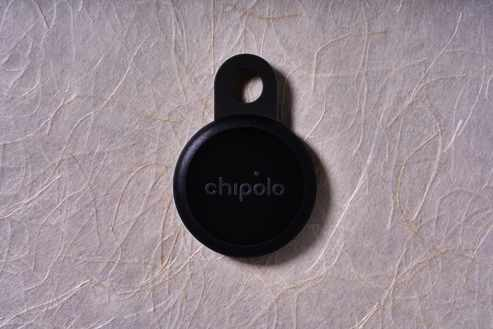
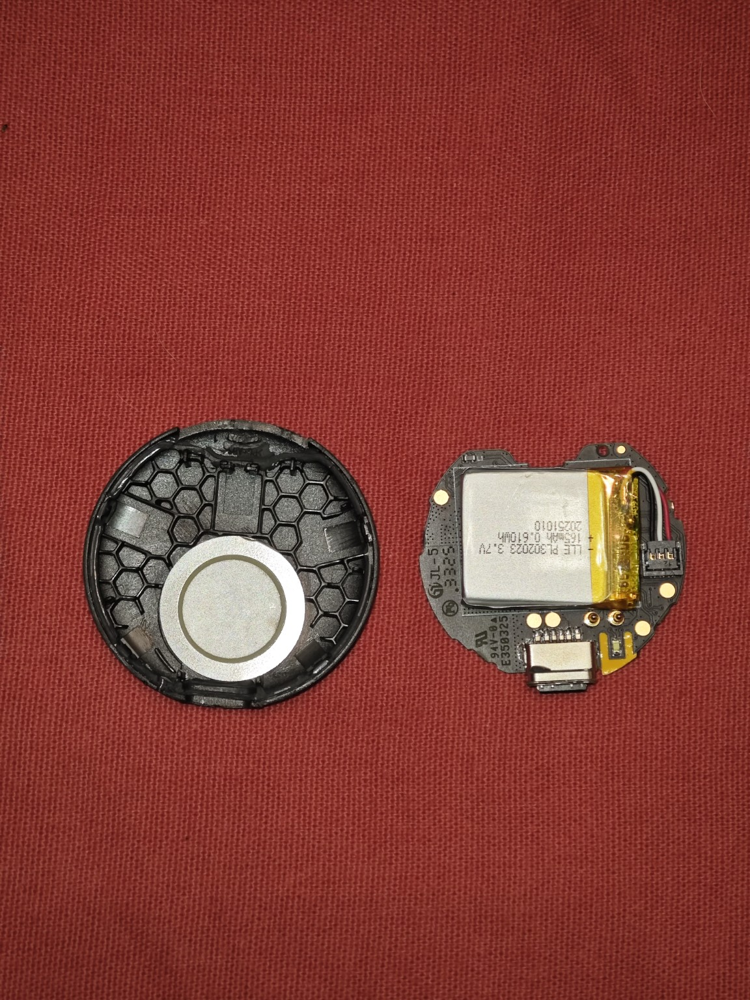
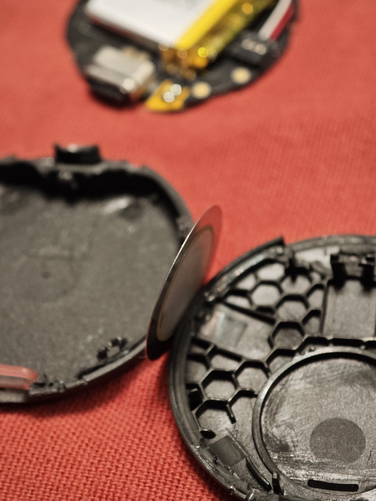
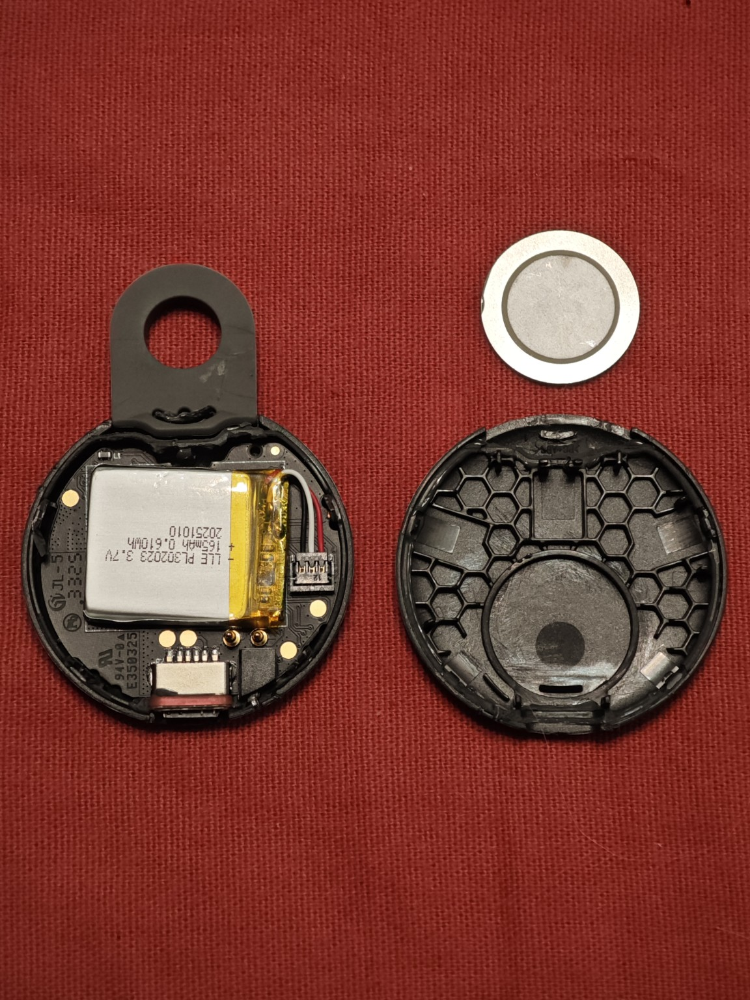
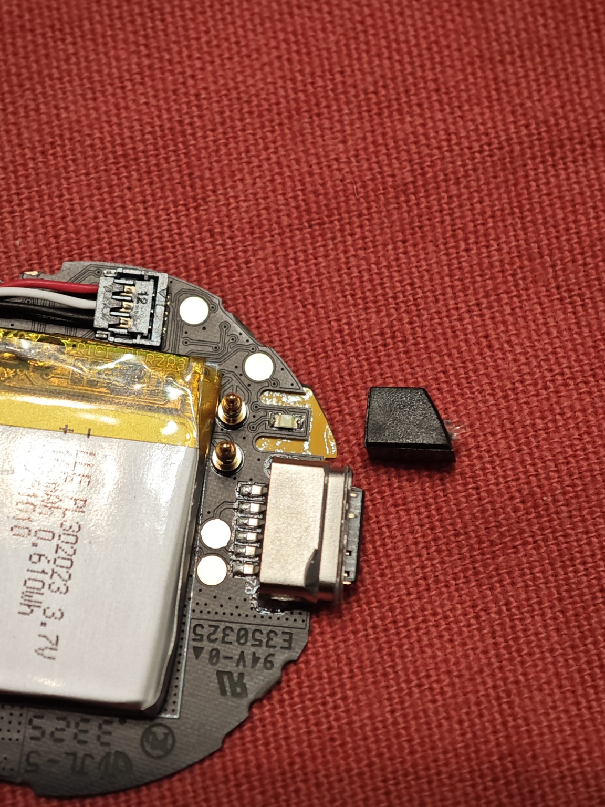
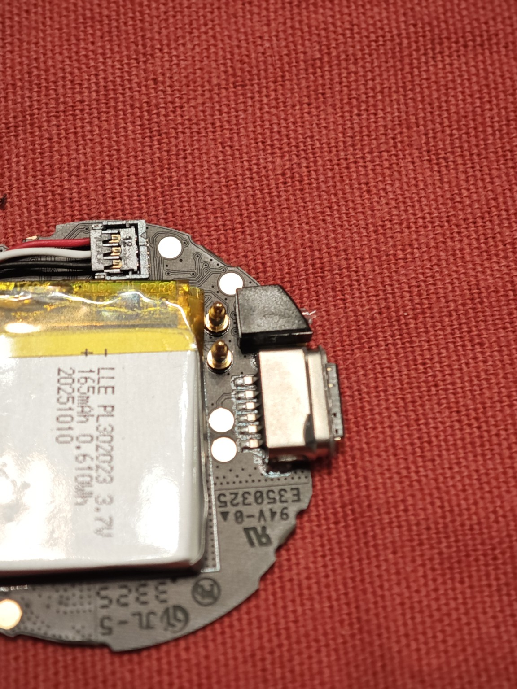
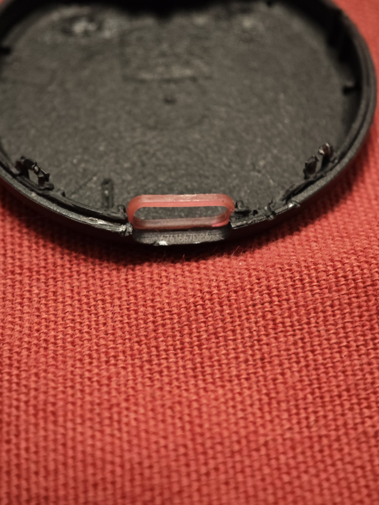
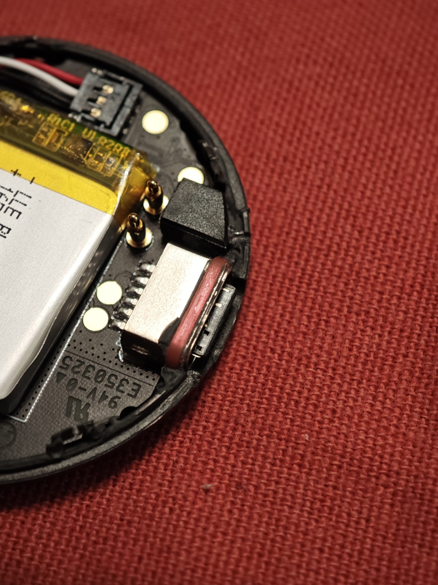

# 🔇 Silent Chipolo LOOP

**A simple, step-by-step photo guide to removing the internal sound disc.**

---

Some Chipolo LOOP users have reported unexpected beeping, even at night. This guide shows how to remove the internal sound disc, with step-by-step photos and the small parts to check before closing the case.

> [!WARNING]
> **Removing the disc disables all sound**, including the ring feature and audible unwanted-tracking safety alerts. Opening the case may also affect the warranty and water resistance. Only modify a device you own. Never use a tracker to follow someone without their knowledge and consent.

## 🧰 What you need

- A very thin tool to start opening the case
- A plastic opening pick or an old card
- Tweezers (optional)
- A small amount of plastic-safe adhesive, only if the case does not stay closed

> [!IMPORTANT]
> There is a **lithium battery inside**. Do not puncture, bend, or press against it. Keep the opening tool close to the outer edge of the case, and never work on the device while it is charging.

## 🔧 Step-by-step

### 01. Open the case

Start at the **seam near the rubber loop**. Gently insert a thin tool just far enough to make a small gap, then use it as a lever to lift the edge.

Switch to a plastic pick if possible, and slowly work around the seam to release the adhesive. **Do not push the tool deep inside.**

### 02. Separate the two halves

Carefully lift the cover away. You should see the **circuit board and battery on one side** and the **thin, round sound disc in the cover**.

  
   The two halves after opening.

### 03. Find the sound disc

The sound disc is the **thin, silver, round part** attached inside the cover. It is held by adhesive and can bend easily, so handle it carefully.

  
   A side view of the thin sound disc.

### 04. Remove the disc

Gently lift the disc and peel it away from the adhesive. Try to **keep it flat and undamaged**.

**Keep the original disc.** You may be able to reinstall it later if it is intact and makes proper contact.

  
   The removed disc next to the opened tracker.

### 05. Put the light guide back

Near the **USB-C port**, there is a small **black light guide**. It allows the status light to shine through the case and may come loose while opening it.

**Make sure it is back in its original position before closing the tracker.**

  
   Light guide removed.

  
   Light guide back in place.

### 06. Check the rubber seal

**Do not forget the red rubber seal around the USB-C area.** Check that it is correctly seated and not trapped between the two halves of the case.

  
   Sealing area inside the cover.

  
   Rubber seal near the USB-C connector.

> [!NOTE]
> Even with the seal in place, the original **IP67 water and dust resistance is not guaranteed** after opening the tracker.

### 07. Close the tracker

Before closing, check these two small parts again: the **light guide** and the **USB-C rubber seal**.

Align the two halves and press them together carefully. If the original adhesive no longer holds, apply a small amount of **plastic-safe adhesive along the outer housing edge**, away from the electronics and USB-C port. Let it set according to the adhesive instructions.

Finally, confirm that the **status light, Bluetooth connection, and USB-C charging** still work.

## ✅ What changes?

| Feature | After removing the disc |
| :--- | :--- |
| 🔇 Sound | Disabled, including ringing and audible safety alerts |
| 🔁 Reinstallation | Possible if the original disc is undamaged and the contacts still work |
| 📶 Bluetooth | Expected to work; test it after closing |
| 🔌 USB-C charging | Expected to work; test it after closing |
| 💧 Water resistance | Original IP67 protection is no longer guaranteed |

## 📋 Technical specifications

<strong>Show original Chipolo LOOP specifications</strong>

| Feature | Original Chipolo LOOP |
| :--- | :--- |
| Bluetooth | BLE 6.0 |
| Range | Up to 120 m / 400 ft in ideal conditions |
| Sound | Approx. 125 dB before modification |
| Charging | USB-C |
| Battery life | Up to 1 year per charge (manufacturer claim) |
| Dimensions | 40 × 57 × 8 mm |
| Original protection | IP67 |
| Network support | Apple Find My or Google Find Hub, one at a time |
| Battery inside this unit | 3.7 V, 165 mAh, 0.610 Wh |

[Official Chipolo LOOP specifications](https://chipolo.net/en/products/chipolo-loop). Battery label values are from the unit shown in this guide.

---

This is an unofficial personal modification and is not approved by Chipolo. Keep the removed disc if you want the option to restore sound later.
